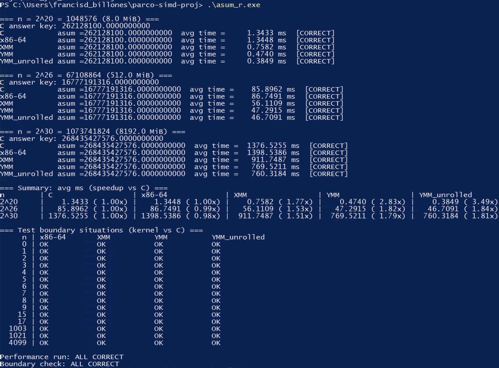

## Benchmark Setup

| | |
| :--- | :--- |
| Machine | Google Cloud `c2-standard-4` |
| OS | Windows Server 2025 Datacenter |
| CPU | Intel Xeon @ 3.10 GHz (Cascade Lake), 4 vCPUs |
| Cache | L2: 2 MB, L3: 24.75 MB (shared) |
| RAM | 16 GB |
| Vector init | `A[i] = (i % 1000) - 500` |
| # of runs | 30 |

## Program Output

### Release

### Debug

## Analysis

#### Table 1: Release build

| N | C | x86-64 | XMM | YMM | YMM Unrolled |
| :--- | ---: | ---: | ---: | ---: | ---: |
| 2^20 | 1.3433 ms | 1.3448 ms (1.00x) | 0.7582 ms (1.77x) | 0.4740 ms (2.83x) | 0.3849 ms (3.49x) |
| 2^26 | 85.9 ms | 86.7 ms (0.99x) | 56.1 ms (1.53x) | 47.3 ms (1.82x) | 46.7 ms (1.84x) |
| 2^30 | 1376.5 ms | 1398.5 ms (0.98x) | 911.7 ms (1.51x) | 769.5 ms (1.79x) | 760.3 ms (1.81x) |
| **Geo. mean** | - | 0.99x | 1.60x | 2.10x | 2.26x |

#### Table 2: Debug build

| N | C | x86-64 | XMM | YMM | YMM Unrolled |
| :--- | ---: | ---: | ---: | ---: | ---: |
| 2^20 | 2.6660 ms | 1.3336 ms (2.00x) | 0.6873 ms (3.88x) | 0.4338 ms (6.15x) | 0.3395 ms (7.85x) |
| 2^26 | 169.7 ms | 86.8 ms (1.96x) | 56.2 ms (3.02x) | 47.6 ms (3.57x) | 46.5 ms (3.65x) |
| 2^30 | 2717.9 ms | 1394.4 ms (1.95x) | 904.0 ms (3.01x) | 760.3 ms (3.57x) | 752.0 ms (3.61x) |
| **Geo. mean** | - | 1.97x | 3.28x | 4.28x | 4.69x |

## Problems Encountered and AHA Moments

### Problems

**1. Unreliable timings on a laptop.** The first few times we ran the full benchmark were on a laptop with other applications open. The assembly kernels should not be affected by compiling in Debug or Release mode, yet their times differed by up to 25%. We hypothesized that this was because of background applications introducing noise, so we opted to benchmark in a cloud Windows Server machine, which runs significantly less background processes.

**2. Correct kernels reported as WRONG at 2^30.** The very first init we used was `A[i] = i`, which is the same one we used in the in-person group exercises. At n = 2^30 however, the sum is about 5.8 * 10^17 which is greater than 2^53, the point at which doubles can no longer represent integers accurately. Also, there were no negative values to actually test the absolute value capabilities.

As an alternative we picked `A[i] = (i % 1000) - 500`, which means every value is within the range `[-500, 500)`. The largest possible sum for this is below 2^53. 

**3. XMM kernel crashed on the benchmark machine but not on the personal laptop.** The mask is loaded with `vmodqa` which assumes 16-byte alignment. The mask already had `align 16`, but turns out NASM requires another `section .data align=16` to actually align the mask in memory.

## Conclusion